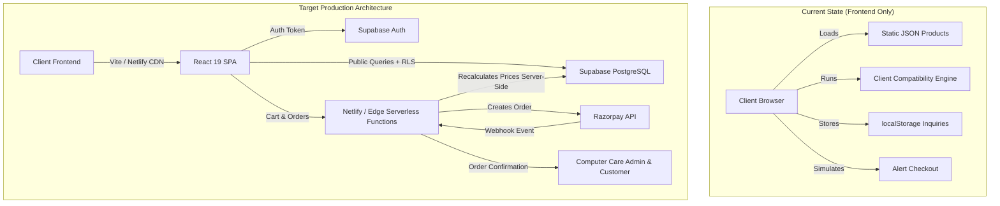

# COMPUTER CARE — BACKEND ARCHITECTURAL AUDIT & READINESS REPORT
**Project:** Computer Care E-Commerce Hardware Lab & Custom PC Configurator  
**Repository:** [https://github.com/market13/computerarehub](https://github.com/market13/computerarehub)  
**Live Production URL:** [https://magical-duckanoo-626d44.netlify.app/](https://magical-duckanoo-626d44.netlify.app/)  
**Audit Date:** November 2026  
**Auditor:** Senior Full-Stack E-Commerce Architect & Security Specialist  

---

## 1. EXECUTIVE SUMMARY

Computer Care is an established computer hardware and custom PC-building enterprise based in Ghaziabad, Uttar Pradesh, India. The existing frontend is a high-performance Single Page Application (SPA) built with React 19, Tailwind CSS v3, Vite 8, Lucide React, and Three.js (for 3D cabinet simulation).

The current frontend satisfies the client's visual branding, featuring an EliteHubs/MDComputers-grade e-commerce aesthetic, dual-mode desktop mega menu, mobile navigation bar, an interactive 10-slot PC configurator, and 582 curated hardware items across 15 authorized partner brands (Lenovo, Samsung, HP, Cosmic Byte, Zebronics, Lapcare, Ant Esports, Acer, TVS, Consistent, iBall, Geonix, ProDot, Logitech, Dell, and Computer Care).

However, **there is currently no backend infrastructure in place**. All product catalogs and presets are loaded from static JSON files (`/data/products.json`, `/data/presets.json`), cart state is purely ephemeral in-memory React state, custom PC configurations cannot be saved to a database or shared via URL, inquiries are saved to `localStorage`, and the checkout triggers an `alert()` box rather than creating a secure server-side transaction.

This audit details the complete findings across the existing codebase, identifies critical functional and security gaps, and lays out the blueprint for a production-grade backend leveraging Supabase (PostgreSQL, Auth, Storage, Edge Functions) and Razorpay.

---

## 2. REPOSITORY & CODEBASE ARCHITECTURE AUDIT

### 2.1 Workspace Structure
```
custom-pc-builder/
├── .git/                                # Git version control
├── client/                              # Vite + React 19 Frontend
│   ├── public/
│   │   ├── data/
│   │   │   ├── products.json            # 582 products across 19 categories (Static)
│   │   │   └── presets.json             # 3 prebuilt PC configurations (Static)
│   │   └── images/                      # High-res hardware & banner assets
│   ├── src/
│   │   ├── assets/                      # Icons & branding
│   │   ├── components/                  # 23 UI view & modal components
│   │   │   ├── Header.jsx               # Mega-menu, search, brand links, user/cart icons
│   │   │   ├── HomeView.jsx             # Hero, shop-by-category, specialities, featured rigs
│   │   │   ├── PCBuilderView.jsx        # 10-slot custom PC configurator
│   │   │   ├── CatalogView.jsx          # Filterable catalog with brand & style facets
│   │   │   ├── CartDrawer.jsx           # Slide-out cart drawer
│   │   │   ├── ComponentSelectorModal.jsx # Component picker with real-time specs
│   │   │   ├── ProductDetailModal.jsx   # Spec sheet modal with WhatsApp enquiry
│   │   │   ├── PrebuiltPresetsModal.jsx # Preset build selection
│   │   │   ├── ExpertConsultationForm.jsx # Callback / custom build request form
│   │   │   ├── BulkOrderView.jsx        # B2B institutional quotation form
│   │   │   ├── MobileBottomNav.jsx      # Mobile sticky bottom navigation
│   │   │   ├── WhatsAppFloatingButton.jsx # Floating WhatsApp support widget
│   │   │   └── Cabinet3DViewer.jsx      # Three.js 3D cabinet simulation
│   │   ├── utils/
│   │   │   ├── compatibility.js         # Deterministic PC compatibility engine
│   │   │   └── themePresets.js          # Cabinet RGB lighting presets
│   │   ├── App.jsx                      # Root state orchestrator & tab router
│   │   └── main.jsx                     # DOM mount point
│   ├── package.json                     # React 19, Vite 8, Tailwind 3.4
│   └── vite.config.js                   # Vite configuration
├── netlify.toml                         # Build & deployment rules
├── package.json                         # Workspace orchestrator
└── README.md
```

### 2.2 Technology Stack
| Layer | Current Implementation | Target Production Implementation |
|---|---|---|
| **Frontend Framework** | React 19.3.1 + Vite 8.3.4 | React 19.3.1 + Vite 8.3.4 (Preserved) |
| **Styling** | Tailwind CSS v3.4.17 | Tailwind CSS v3.4.17 (Preserved) |
| **Routing** | In-memory `activeTab` state | Hybrid Tab + URL Hash/Query Deep Linking |
| **Database** | None (Static JSON files) | Supabase Managed PostgreSQL |
| **Authentication** | None (Mock guest alerts) | Supabase Auth (JWT, Row Level Security) |
| **Storage** | Local public assets | Supabase Storage (product-images, specs, invoices) |
| **Payment Gateway** | None (Client alert popup) | Razorpay Orders API + Webhook HMAC Verification |
| **Serverless Backend** | None | Netlify Functions / Supabase Edge Functions |
| **State Management** | React `useState` / props drilling | React Context / Zustand / DB Synchronization |

---

## 3. AUDIT OF EXISTING ROUTES, COMPONENTS & FORMS

### 3.1 Routing Architecture
- **Current Behavior:** Routing is controlled in `App.jsx` via `activeTab` (`'home'`, `'builder'`, `'catalog'`, `'bulk-order'`).
- **Issues:**
  1. No browser history navigation (back/forward button does not work).
  2. Reloading the page always resets the user back to the `'home'` tab.
  3. No shareable deep links for specific products (`/catalog?product=980201`), categories (`/catalog?cat=gpu`), or saved PC builds (`/builder?config=uuid`).
- **Recommendation:** Implement shallow URL query/hash parameter synchronization (`window.history.pushState` or lightweight router) that integrates seamlessly into `activeTab` without breaking existing tab transitions.

### 3.2 Product Catalog & Detail Pages
- **Current Behavior:** 582 products loaded over HTTP from `/data/products.json`. Clicking a product triggers `setDetailProduct(product)`, opening `ProductDetailModal.jsx`.
- **Issues:**
  1. Cannot index individual product URLs for search engines (SEO deficiency).
  2. Inventory stock quantities are static booleans (`available: true`) rather than real-time integers.
  3. Cost prices and purchase margins are absent; selling prices are statically hardcoded.
  4. Adding or updating a product requires rebuilding and redeploying the frontend.

### 3.3 Custom PC Builder (`PCBuilderView.jsx`)
- **Current Behavior:** Supports 10 component slots:
  1. Case / Cabinet (`case`)
  2. Cabinet Cooling Fans (`case_fan`)
  3. Processor (`cpu`)
  4. Motherboard (`motherboard`)
  5. Memory (`ram`)
  6. Graphics Card (`gpu`)
  7. CPU Cooler / AIO (`cooler`)
  8. Storage SSD/NVMe (`storage`)
  9. Power Supply Unit (`psu`)
  10. Gaming Monitor (`monitor`)
- **Issues:**
  1. **Share Build:** Copies plain text to clipboard. No unique configuration ID or permalink is generated.
  2. **Save Build:** No ability for logged-in users to save multiple builds (e.g. "Draft 4K Gaming Rig", "Office Workstation").
  3. **Cart Integration:** Adding to cart only populates the single active build in `CartDrawer`.
  4. **Quotation Workflow:** Does not submit configurations to a backend quotations table.

### 3.4 Compatibility Engine (`compatibility.js`)
- **Current Rules Implemented:**
  - CPU & Motherboard socket string comparison.
  - Motherboard & RAM DDR generation match.
  - Motherboard form-factor vs Cabinet supported form-factors.
  - GPU length (mm) vs Cabinet max clearance (mm).
  - Estimated wattage calculation with 30% PSU headroom.
  - CPU TDP vs Cooler dissipation rating.
- **Missing Rules & Edge Cases:**
  - Multi-slot RAM checks: Channel limits, max memory capacity (GB), slot count (2 slots vs 4 slots).
  - Storage connectivity: M.2 NVMe PCIe generation, M.2 slot availability, SATA port count.
  - Cabinet radiator placement: 240mm/360mm radiator clearance at top/front.
  - PSU power connectors: GPU 12VHPWR (PCIe 5.0 16-pin) vs 8-pin PCIe power requirement.
  - BIOS revision dependency: Warning for 14th Gen Intel on 600/700 series boards or Ryzen 5000 on B450 boards.
  - Server-Side Execution: Compatibility is currently client-side only. A malicious client could send incompatible configurations to the checkout API.

### 3.5 Shopping Cart (`CartDrawer.jsx`)
- **Critical Architectural Flaw:**
  - The cart drawer is tightly bound to `build`!
  - It filters non-null items in `build` and renders them.
  - **A customer CANNOT purchase a standalone keyboard, mouse, or graphics card from the catalog without building an entire PC!**
  - Quantity cannot be incremented (each component slot only holds 1 item).
  - No coupon code support.
  - No server-side pricing or stock validation.
  - Checkout calls `alert()` and triggers confetti.

### 3.6 Existing Forms
1. **`ExpertConsultationForm.jsx`**:
   - Fields: Full Name, Phone, Email, City, Budget, Use Case, Notes.
   - Saves record into `localStorage.getItem('computercare_pc_consultations')`.
   - Generates mock reference number `CC-TECH-XXXXXX`.
2. **`BulkOrderView.jsx`**:
   - Fields: Full Name, Company, Email, Phone, City, State, GSTIN, Category, Quantity, Timeline, Budget, Description.
   - Saves record into `localStorage.getItem('computercare_bulk_inquiries')`.
   - Generates mock reference number `CC-B2B-XXXXXX`.
- **Issues:** Neither form persists data to a database, neither triggers an SMS/WhatsApp/Email notification to the Computer Care sales team, and neither can be viewed or managed in an administrative dashboard.

---

## 4. CURRENT API INTEGRATIONS & INFRASTRUCTURE AUDIT

| Integration | Current State | Defect / Risk |
|---|---|---|
| **Product API** | Static JSON file fetch | Static; no pagination on server, no inventory reservations |
| **Payment Gateway** | None | Simulated client alert; impossible to receive actual money online |
| **Authentication** | None | No secure user accounts; cannot track orders or customer profiles |
| **File Storage** | Static public images | Admins cannot upload new product photos dynamically |
| **Analytics** | None | No tracking of order conversion, cart abandonment, or popular builds |
| **Transactional Email/SMS** | None | Customers receive zero automated order or quotation confirmation |

---

## 5. SECURITY & COMPLIANCE AUDIT

### 5.1 Vulnerabilities & Weaknesses Identified
1. **Price Manipulation Vulnerability (Critical):**
   - The frontend currently calculates all prices and subtotals.
   - If an order were submitted directly from the client without server recalculation, an attacker could tamper with payload JSON and purchase a ₹1,50,000 RTX 4090 rig for ₹1.
2. **Missing Service-Role & Secret Isolation:**
   - When introducing Supabase and Razorpay, backend secrets (`SUPABASE_SERVICE_ROLE_KEY`, `RAZORPAY_KEY_SECRET`, `RAZORPAY_WEBHOOK_SECRET`) must never enter `client/` or client-side bundles.
   - Vite environment variables prefixed with `VITE_` are publicly accessible in the browser bundle. Only public anon keys (`VITE_SUPABASE_URL`, `VITE_SUPABASE_ANON_KEY`, `VITE_RAZORPAY_KEY_ID`) are safe for frontend exposure.
3. **Data Loss & Session Insecurity:**
   - Because consultation requests and bulk inquiries live only in `localStorage`, clearing browser data permanently erases customer leads.
4. **Lack of Row Level Security (RLS):**
   - Direct database access from client without strict PostgreSQL RLS would allow any authenticated user to view other customers' orders, addresses, or quotations.
5. **Admin Access Escalation Risk:**
   - Admin routes must be verified at the database/JWT claim level (`role = 'admin'` or profile table flag), not merely hidden behind a frontend `isAdmin` boolean state.

---

## 6. DEPLOYMENT & NETLIFY AUDIT

- **Build Pipeline:** Root `package.json` builds `client/` via `npm --prefix client run build` and copies `client/dist` to `dist`.
- **Redirects:** Netlify rewrite rule `/* -> /index.html` (200 status) is properly configured for Single Page Apps.
- **Headers:** Security headers (`X-Frame-Options: DENY`, `X-Content-Type-Options: nosniff`, `X-XSS-Protection`) are enabled in `netlify.toml`.
- **Functions Directory:** Currently missing a dedicated `functions/` or `netlify/functions/` directory. For server-side Razorpay order creation and webhook verification, Netlify Functions must be configured in `netlify.toml`.

---

## 7. GAP ANALYSIS SUMMARY



---

## 8. ACTIONABLE RECOMMENDATIONS & TARGET PHASES

To achieve a production-ready, enterprise-grade e-commerce backend without disrupting the existing frontend design, development must proceed in 8 distinct phases:

1. **Phase 1: Database Architecture & Supabase Foundation**
   - Create fully normalized PostgreSQL schema with 22 tables.
   - Implement Row Level Security (RLS) policies, triggers, and indices.
   - Setup Supabase client library with safe fallback modes.
2. **Phase 2: Product & Inventory Management**
   - Migrate 582 products and 19 categories into PostgreSQL.
   - Build server-side pagination, category facets, and search.
   - Create Admin product management (CRUD, price adjustments, stock updates).
3. **Phase 3: Custom PC Builder & Server Compatibility Engine**
   - Enable configuration persistence (`pc_configurations` table).
   - Generate unique 12-character alphanumeric build IDs and shareable URLs (`?config=UUID`).
   - Server-side compatibility validator for cart checkout.
4. **Phase 4: Customer Authentication & Profiles**
   - Supabase Auth integration (Email/Password, Magic Link, Profile, Saved Addresses).
   - Wishlist persistence across sessions.
   - Customer Order History and Saved PC Rigs dashboard.
5. **Phase 5: Unified Cart, Server-Side Pricing & Checkout Engine**
   - Redesign Cart to support both standalone items and custom PC rigs.
   - Serverless price verification function (zero client trust).
   - Stock reservation and coupon validation.
6. **Phase 6: Razorpay Payment Processing & Webhooks**
   - Server-side order creation (`orders.create`).
   - Client Razorpay Checkout SDK invocation.
   - HMAC-SHA256 signature verification (`verify-payment`).
   - Idempotent Webhook listener for payment captures and failures.
7. **Phase 7: Admin Panel, Quotation Workflow & Order Management**
   - Secure Admin Dashboard (`/admin` tab with role-based guard).
   - Order lifecycle workflow (Pending -> Confirmed -> Building -> Quality Check -> Shipped).
   - Quotation manager (Review B2B inquiries and custom builds, generate price quotes).
8. **Phase 8: Security Hardening, Automated Verification & Deployment**
   - Automated Playwright and API tests for checkout, cart tampering, and compatibility.
   - Production build verification and Netlify deployment readiness.
