# COMPUTER CARE — RELATIONAL DATABASE ARCHITECTURE & SCHEMA SPECIFICATION
**Engine:** PostgreSQL 15+ (Supabase)  
**Security Model:** Row Level Security (RLS) enabled on all tables  
**Schema Version:** 1.0.0  
**Currency Standard:** Indian Rupee (INR / ₹) stored as integer in Paise (or numeric INR) to prevent floating-point rounding errors  

---

## 1. ENTITY-RELATIONSHIP ARCHITECTURE

```mermaid
erDiagram
    PROFILES ||--o{ CUSTOMER_ADDRESSES : "has many"
    PROFILES ||--o{ ORDERS : "places"
    PROFILES ||--o{ PC_CONFIGURATIONS : "creates"
    PROFILES ||--o{ CARTS : "owns"
    PROFILES ||--o{ WISHLISTS : "saves"
    PROFILES ||--o{ QUOTATIONS : "requests"

    BRANDS ||--o{ PRODUCTS : "manufactures"
    CATEGORIES ||--o{ PRODUCTS : "classifies"
    PRODUCTS ||--o{ PRODUCT_SPECIFICATIONS : "specifies"
    PRODUCTS ||--o{ PRODUCT_IMAGES : "has"
    PRODUCTS ||--o{ PRODUCT_INVENTORY : "tracks stock"

    PC_CONFIGURATIONS ||--o{ PC_CONFIGURATION_ITEMS : "contains"
    PRODUCTS ||--o{ PC_CONFIGURATION_ITEMS : "configured as"

    CARTS ||--o{ CART_ITEMS : "contains"
    PRODUCTS ||--o{ CART_ITEMS : "added to cart"
    PC_CONFIGURATIONS ||--o{ CART_ITEMS : "bundle item"

    ORDERS ||--o{ ORDER_ITEMS : "contains"
    ORDERS ||--o{ ORDER_STATUS_HISTORY : "tracks lifecycle"
    ORDERS ||--o{ PAYMENTS : "paid by"
    ORDERS ||--|| SHIPPING_DETAILS : "dispatched via"

    COUPONS ||--o{ COUPON_REDEMPTIONS : "redeemed in"
    ORDERS ||--o{ COUPON_REDEMPTIONS : "applies"

    QUOTATIONS ||--o{ QUOTATION_ITEMS : "quotes"
    WISHLISTS ||--o{ WISHLIST_ITEMS : "contains"
```



---

## 2. COMPREHENSIVE TABLE DEFINITIONS

### 2.1 Identity, Users & Customer Profiles

```sql
-- 1. profiles: Extends supabase auth.users
CREATE TABLE public.profiles (
    id UUID PRIMARY KEY REFERENCES auth.users(id) ON DELETE CASCADE,
    email TEXT NOT NULL UNIQUE,
    full_name TEXT NOT NULL,
    phone TEXT,
    role TEXT NOT NULL DEFAULT 'customer' CHECK (role IN ('customer', 'admin', 'sales', 'technician')),
    avatar_url TEXT,
    gstin TEXT,
    company_name TEXT,
    created_at TIMESTAMPTZ NOT NULL DEFAULT timezone('utc'::text, now()),
    updated_at TIMESTAMPTZ NOT NULL DEFAULT timezone('utc'::text, now())
);

-- 2. customer_addresses: Saved shipping & billing addresses
CREATE TABLE public.customer_addresses (
    id UUID PRIMARY KEY DEFAULT gen_random_uuid(),
    user_id UUID NOT NULL REFERENCES public.profiles(id) ON DELETE CASCADE,
    address_type TEXT NOT NULL DEFAULT 'shipping' CHECK (address_type IN ('shipping', 'billing', 'both')),
    recipient_name TEXT NOT NULL,
    phone TEXT NOT NULL,
    alternate_phone TEXT,
    street_address TEXT NOT NULL,
    landmark TEXT,
    city TEXT NOT NULL,
    state TEXT NOT NULL,
    postal_code TEXT NOT NULL CHECK (postal_code ~ '^[1-9][0-9]{5}$'), -- 6-digit Indian PIN
    is_default BOOLEAN NOT NULL DEFAULT false,
    created_at TIMESTAMPTZ NOT NULL DEFAULT timezone('utc'::text, now()),
    updated_at TIMESTAMPTZ NOT NULL DEFAULT timezone('utc'::text, now())
);
```

### 2.2 Product Catalog, Brands & Categories

```sql
-- 3. brands: Hardware manufacturers & vendors
CREATE TABLE public.brands (
    id UUID PRIMARY KEY DEFAULT gen_random_uuid(),
    name TEXT NOT NULL UNIQUE,
    slug TEXT NOT NULL UNIQUE,
    logo_url TEXT,
    website TEXT,
    is_authorized_partner BOOLEAN NOT NULL DEFAULT false,
    created_at TIMESTAMPTZ NOT NULL DEFAULT timezone('utc'::text, now())
);

-- 4. categories: Component & peripheral categories
CREATE TABLE public.categories (
    id UUID PRIMARY KEY DEFAULT gen_random_uuid(),
    key TEXT NOT NULL UNIQUE, -- e.g. 'cpu', 'gpu', 'motherboard', 'gaming_pc'
    name TEXT NOT NULL,
    slug TEXT NOT NULL UNIQUE,
    description TEXT,
    icon_name TEXT,
    image_url TEXT,
    is_pc_component BOOLEAN NOT NULL DEFAULT false,
    display_order INTEGER NOT NULL DEFAULT 0,
    created_at TIMESTAMPTZ NOT NULL DEFAULT timezone('utc'::text, now())
);

-- 5. products: Master hardware & systems inventory
CREATE TABLE public.products (
    id BIGINT PRIMARY KEY GENERATED ALWAYS AS IDENTITY,
    legacy_id BIGINT UNIQUE, -- Maps to 980201 etc. from initial json
    sku TEXT NOT NULL UNIQUE,
    name TEXT NOT NULL,
    handle TEXT NOT NULL UNIQUE,
    brand_id UUID NOT NULL REFERENCES public.brands(id),
    category_id UUID NOT NULL REFERENCES public.categories(id),
    category_key TEXT NOT NULL REFERENCES public.categories(key),
    model TEXT,
    description TEXT NOT NULL,
    short_description TEXT,
    purchase_price NUMERIC(12, 2) NOT NULL DEFAULT 0.00, -- Admin only! Never expose to client
    selling_price NUMERIC(12, 2) NOT NULL CHECK (selling_price >= 0),
    mrp_price NUMERIC(12, 2) NOT NULL CHECK (mrp_price >= selling_price),
    warranty_months INTEGER NOT NULL DEFAULT 12,
    warranty_info TEXT DEFAULT 'Brand Authorized Service Center Warranty',
    is_featured BOOLEAN NOT NULL DEFAULT false,
    is_available BOOLEAN NOT NULL DEFAULT true,
    is_archived BOOLEAN NOT NULL DEFAULT false,
    created_at TIMESTAMPTZ NOT NULL DEFAULT timezone('utc'::text, now()),
    updated_at TIMESTAMPTZ NOT NULL DEFAULT timezone('utc'::text, now())
);

-- 6. product_specifications: Structured hardware attributes for compatibility engine
CREATE TABLE public.product_specifications (
    id UUID PRIMARY KEY DEFAULT gen_random_uuid(),
    product_id BIGINT NOT NULL REFERENCES public.products(id) ON DELETE CASCADE UNIQUE,
    socket TEXT,                -- e.g. 'LGA1700', 'AM5', 'LGA1155'
    ram_type TEXT,              -- e.g. 'DDR4', 'DDR5'
    ram_slots INTEGER,          -- e.g. 2, 4
    form_factor TEXT,           -- e.g. 'ATX', 'Micro-ATX', 'Mini-ITX'
    wattage INTEGER,            -- e.g. 650, 750, 850 (for PSU)
    tdp INTEGER,                -- e.g. 65, 125, 250 (for CPU & GPU)
    tdp_rating INTEGER,         -- e.g. 180, 250 (for Cooler)
    max_gpu_length_mm INTEGER,  -- Cabinet GPU clearance
    gpu_length_mm INTEGER,      -- Physical GPU length
    radiator_size_mm INTEGER,   -- 120, 240, 280, 360
    cooler_type TEXT,           -- 'Air Cooler', 'Liquid AIO'
    storage_interface TEXT,     -- 'M.2 NVMe PCIe 4.0', 'SATA 2.5'
    psu_efficiency TEXT,        -- '80 Plus Bronze', '80 Plus Gold'
    pcie_power_connectors TEXT, -- e.g. '1x 16-pin 12VHPWR', '2x 8-pin'
    additional_specs JSONB NOT NULL DEFAULT '{}'::jsonb
);

-- 7. product_images: Multi-image gallery per product
CREATE TABLE public.product_images (
    id UUID PRIMARY KEY DEFAULT gen_random_uuid(),
    product_id BIGINT NOT NULL REFERENCES public.products(id) ON DELETE CASCADE,
    image_url TEXT NOT NULL,
    alt_text TEXT,
    display_order INTEGER NOT NULL DEFAULT 0,
    is_primary BOOLEAN NOT NULL DEFAULT false,
    created_at TIMESTAMPTZ NOT NULL DEFAULT timezone('utc'::text, now())
);

-- 8. product_inventory: Real-time stock counts & reservations
CREATE TABLE public.product_inventory (
    id UUID PRIMARY KEY DEFAULT gen_random_uuid(),
    product_id BIGINT NOT NULL REFERENCES public.products(id) ON DELETE CASCADE UNIQUE,
    stock_quantity INTEGER NOT NULL DEFAULT 0 CHECK (stock_quantity >= 0),
    reserved_quantity INTEGER NOT NULL DEFAULT 0 CHECK (reserved_quantity >= 0),
    low_stock_threshold INTEGER NOT NULL DEFAULT 3,
    restock_date DATE,
    updated_at TIMESTAMPTZ NOT NULL DEFAULT timezone('utc'::text, now())
);
```

### 2.3 Custom PC Configurator & Compatibility Engine

```sql
-- 9. pc_configurations: Saved and shared custom PC builds
CREATE TABLE public.pc_configurations (
    id UUID PRIMARY KEY DEFAULT gen_random_uuid(),
    share_code VARCHAR(16) NOT NULL UNIQUE, -- e.g. 'CC-9X4A-82L1'
    user_id UUID REFERENCES public.profiles(id) ON DELETE SET NULL,
    title TEXT NOT NULL DEFAULT 'Custom Gaming Rig',
    target_usage TEXT, -- 'AAA Gaming', '3D Rendering', 'Office', 'AI/ML'
    estimated_wattage INTEGER NOT NULL DEFAULT 0,
    is_compatible BOOLEAN NOT NULL DEFAULT true,
    compatibility_notes JSONB DEFAULT '[]'::jsonb,
    gaming_scores JSONB DEFAULT '{}'::jsonb,
    total_price NUMERIC(12, 2) NOT NULL DEFAULT 0.00,
    is_public BOOLEAN NOT NULL DEFAULT true,
    created_at TIMESTAMPTZ NOT NULL DEFAULT timezone('utc'::text, now()),
    updated_at TIMESTAMPTZ NOT NULL DEFAULT timezone('utc'::text, now())
);

-- 10. pc_configuration_items: Components assigned to slots in a PC configuration
CREATE TABLE public.pc_configuration_items (
    id UUID PRIMARY KEY DEFAULT gen_random_uuid(),
    configuration_id UUID NOT NULL REFERENCES public.pc_configurations(id) ON DELETE CASCADE,
    slot_key TEXT NOT NULL CHECK (slot_key IN (
        'case', 'case_fan', 'cpu', 'motherboard', 'ram', 
        'gpu', 'cooler', 'storage', 'psu', 'monitor'
    )),
    product_id BIGINT NOT NULL REFERENCES public.products(id),
    quantity INTEGER NOT NULL DEFAULT 1 CHECK (quantity > 0),
    unit_price NUMERIC(12, 2) NOT NULL, -- Price snapshot at time of build
    created_at TIMESTAMPTZ NOT NULL DEFAULT timezone('utc'::text, now()),
    UNIQUE(configuration_id, slot_key)
);
```

### 2.4 Shopping Carts & Server-Side Checkout

```sql
-- 11. carts: Customer and guest active carts
CREATE TABLE public.carts (
    id UUID PRIMARY KEY DEFAULT gen_random_uuid(),
    user_id UUID REFERENCES public.profiles(id) ON DELETE CASCADE,
    session_token TEXT UNIQUE, -- For guest checkout
    created_at TIMESTAMPTZ NOT NULL DEFAULT timezone('utc'::text, now()),
    updated_at TIMESTAMPTZ NOT NULL DEFAULT timezone('utc'::text, now())
);

-- 12. cart_items: Individual products or whole PC builds in cart
CREATE TABLE public.cart_items (
    id UUID PRIMARY KEY DEFAULT gen_random_uuid(),
    cart_id UUID NOT NULL REFERENCES public.carts(id) ON DELETE CASCADE,
    product_id BIGINT REFERENCES public.products(id) ON DELETE CASCADE,
    pc_configuration_id UUID REFERENCES public.pc_configurations(id) ON DELETE CASCADE,
    item_type TEXT NOT NULL CHECK (item_type IN ('standalone_product', 'custom_pc_build')),
    quantity INTEGER NOT NULL DEFAULT 1 CHECK (quantity > 0),
    created_at TIMESTAMPTZ NOT NULL DEFAULT timezone('utc'::text, now()),
    updated_at TIMESTAMPTZ NOT NULL DEFAULT timezone('utc'::text, now()),
    CONSTRAINT item_reference_check CHECK (
        (item_type = 'standalone_product' AND product_id IS NOT NULL AND pc_configuration_id IS NULL) OR
        (item_type = 'custom_pc_build' AND pc_configuration_id IS NOT NULL AND product_id IS NULL)
    )
);
```

### 2.5 Orders, Payments & Fulfillment

```sql
-- 13. orders: E-commerce order records
CREATE TABLE public.orders (
    id UUID PRIMARY KEY DEFAULT gen_random_uuid(),
    order_number TEXT NOT NULL UNIQUE, -- e.g. 'CC-ORD-2026-10492'
    user_id UUID REFERENCES public.profiles(id) ON DELETE SET NULL,
    customer_email TEXT NOT NULL,
    customer_phone TEXT NOT NULL,
    customer_name TEXT NOT NULL,
    status TEXT NOT NULL DEFAULT 'pending' CHECK (status IN (
        'pending', 'payment_pending', 'confirmed', 'processing',
        'building', 'quality_check', 'ready_for_dispatch', 
        'shipped', 'delivered', 'cancelled', 'refunded'
    )),
    subtotal NUMERIC(12, 2) NOT NULL CHECK (subtotal >= 0),
    gst_tax NUMERIC(12, 2) NOT NULL DEFAULT 0.00,
    shipping_fee NUMERIC(12, 2) NOT NULL DEFAULT 0.00,
    discount_amount NUMERIC(12, 2) NOT NULL DEFAULT 0.00,
    total_amount NUMERIC(12, 2) NOT NULL CHECK (total_amount >= 0),
    currency TEXT NOT NULL DEFAULT 'INR',
    coupon_id UUID,
    customer_notes TEXT,
    created_at TIMESTAMPTZ NOT NULL DEFAULT timezone('utc'::text, now()),
    updated_at TIMESTAMPTZ NOT NULL DEFAULT timezone('utc'::text, now())
);

-- 14. order_items: Line items for fulfilled orders
CREATE TABLE public.order_items (
    id UUID PRIMARY KEY DEFAULT gen_random_uuid(),
    order_id UUID NOT NULL REFERENCES public.orders(id) ON DELETE CASCADE,
    product_id BIGINT REFERENCES public.products(id) ON DELETE SET NULL,
    pc_configuration_id UUID REFERENCES public.pc_configurations(id) ON DELETE SET NULL,
    item_type TEXT NOT NULL CHECK (item_type IN ('standalone_product', 'custom_pc_build')),
    product_name TEXT NOT NULL,
    sku TEXT NOT NULL,
    unit_price NUMERIC(12, 2) NOT NULL,
    quantity INTEGER NOT NULL CHECK (quantity > 0),
    total_price NUMERIC(12, 2) NOT NULL,
    specs_snapshot JSONB DEFAULT '{}'::jsonb,
    created_at TIMESTAMPTZ NOT NULL DEFAULT timezone('utc'::text, now())
);

-- 15. payments: Razorpay payment lifecycle records
CREATE TABLE public.payments (
    id UUID PRIMARY KEY DEFAULT gen_random_uuid(),
    order_id UUID NOT NULL REFERENCES public.orders(id) ON DELETE CASCADE,
    payment_method TEXT NOT NULL DEFAULT 'razorpay' CHECK (payment_method IN ('razorpay', 'upi', 'bank_transfer', 'cod')),
    razorpay_order_id TEXT UNIQUE,
    razorpay_payment_id TEXT UNIQUE,
    razorpay_signature TEXT,
    amount NUMERIC(12, 2) NOT NULL,
    currency TEXT NOT NULL DEFAULT 'INR',
    status TEXT NOT NULL DEFAULT 'initiated' CHECK (status IN (
        'initiated', 'authorized', 'captured', 'failed', 'refunded'
    )),
    error_code TEXT,
    error_description TEXT,
    raw_payload JSONB DEFAULT '{}'::jsonb,
    created_at TIMESTAMPTZ NOT NULL DEFAULT timezone('utc'::text, now()),
    updated_at TIMESTAMPTZ NOT NULL DEFAULT timezone('utc'::text, now())
);

-- 16. order_status_history: Audit trail of fulfillment transitions
CREATE TABLE public.order_status_history (
    id UUID PRIMARY KEY DEFAULT gen_random_uuid(),
    order_id UUID NOT NULL REFERENCES public.orders(id) ON DELETE CASCADE,
    status TEXT NOT NULL,
    notes TEXT,
    changed_by UUID REFERENCES public.profiles(id),
    created_at TIMESTAMPTZ NOT NULL DEFAULT timezone('utc'::text, now())
);

-- 17. shipping_details: Courier tracking & delivery address snapshot
CREATE TABLE public.shipping_details (
    id UUID PRIMARY KEY DEFAULT gen_random_uuid(),
    order_id UUID NOT NULL REFERENCES public.orders(id) ON DELETE CASCADE UNIQUE,
    courier_partner TEXT, -- 'BlueDart', 'Delhivery', 'DTDC', 'In-Store Pickup'
    tracking_number TEXT,
    tracking_url TEXT,
    dispatched_at TIMESTAMPTZ,
    estimated_delivery_date DATE,
    actual_delivery_date TIMESTAMPTZ,
    shipping_address JSONB NOT NULL,
    created_at TIMESTAMPTZ NOT NULL DEFAULT timezone('utc'::text, now()),
    updated_at TIMESTAMPTZ NOT NULL DEFAULT timezone('utc'::text, now())
);
```

### 2.6 Quotations, Coupons & Wishlists

```sql
-- 18. quotations: Formal price quotes for B2B & custom PC enquiries
CREATE TABLE public.quotations (
    id UUID PRIMARY KEY DEFAULT gen_random_uuid(),
    quotation_number TEXT NOT NULL UNIQUE, -- e.g. 'CC-QT-2026-0814'
    user_id UUID REFERENCES public.profiles(id) ON DELETE SET NULL,
    inquiry_type TEXT NOT NULL CHECK (inquiry_type IN ('custom_pc', 'b2b_bulk', 'consultation')),
    customer_name TEXT NOT NULL,
    company_name TEXT,
    customer_email TEXT NOT NULL,
    customer_phone TEXT NOT NULL,
    city TEXT NOT NULL,
    state TEXT,
    gstin TEXT,
    intended_usage TEXT,
    budget_range TEXT,
    timeline TEXT,
    notes TEXT,
    quoted_subtotal NUMERIC(12, 2) DEFAULT 0.00,
    status TEXT NOT NULL DEFAULT 'pending' CHECK (status IN ('pending', 'reviewed', 'quoted', 'accepted', 'rejected', 'expired')),
    pc_configuration_id UUID REFERENCES public.pc_configurations(id),
    created_at TIMESTAMPTZ NOT NULL DEFAULT timezone('utc'::text, now()),
    updated_at TIMESTAMPTZ NOT NULL DEFAULT timezone('utc'::text, now())
);

-- 19. quotation_items: Itemized components in an official quotation
CREATE TABLE public.quotation_items (
    id UUID PRIMARY KEY DEFAULT gen_random_uuid(),
    quotation_id UUID NOT NULL REFERENCES public.quotations(id) ON DELETE CASCADE,
    product_id BIGINT REFERENCES public.products(id),
    custom_item_name TEXT NOT NULL,
    quantity INTEGER NOT NULL DEFAULT 1,
    unit_price NUMERIC(12, 2) NOT NULL DEFAULT 0.00,
    total_price NUMERIC(12, 2) NOT NULL DEFAULT 0.00,
    created_at TIMESTAMPTZ NOT NULL DEFAULT timezone('utc'::text, now())
);

-- 20. coupons: Promotional discount codes
CREATE TABLE public.coupons (
    id UUID PRIMARY KEY DEFAULT gen_random_uuid(),
    code TEXT NOT NULL UNIQUE,
    discount_type TEXT NOT NULL CHECK (discount_type IN ('percentage', 'fixed_amount')),
    discount_value NUMERIC(12, 2) NOT NULL CHECK (discount_value > 0),
    min_order_amount NUMERIC(12, 2) DEFAULT 0.00,
    max_discount_amount NUMERIC(12, 2),
    usage_limit INTEGER,
    usage_count INTEGER NOT NULL DEFAULT 0,
    valid_from TIMESTAMPTZ NOT NULL DEFAULT timezone('utc'::text, now()),
    valid_until TIMESTAMPTZ,
    is_active BOOLEAN NOT NULL DEFAULT true,
    created_at TIMESTAMPTZ NOT NULL DEFAULT timezone('utc'::text, now())
);

-- 21. coupon_redemptions: Prevent duplicate coupon reuse
CREATE TABLE public.coupon_redemptions (
    id UUID PRIMARY KEY DEFAULT gen_random_uuid(),
    coupon_id UUID NOT NULL REFERENCES public.coupons(id) ON DELETE RESTRICT,
    order_id UUID NOT NULL REFERENCES public.orders(id) ON DELETE CASCADE,
    user_id UUID REFERENCES public.profiles(id),
    discount_applied NUMERIC(12, 2) NOT NULL,
    redeemed_at TIMESTAMPTZ NOT NULL DEFAULT timezone('utc'::text, now()),
    UNIQUE(coupon_id, order_id)
);

-- 22. wishlists & wishlist_items
CREATE TABLE public.wishlists (
    id UUID PRIMARY KEY DEFAULT gen_random_uuid(),
    user_id UUID NOT NULL REFERENCES public.profiles(id) ON DELETE CASCADE UNIQUE,
    created_at TIMESTAMPTZ NOT NULL DEFAULT timezone('utc'::text, now())
);

CREATE TABLE public.wishlist_items (
    id UUID PRIMARY KEY DEFAULT gen_random_uuid(),
    wishlist_id UUID NOT NULL REFERENCES public.wishlists(id) ON DELETE CASCADE,
    product_id BIGINT NOT NULL REFERENCES public.products(id) ON DELETE CASCADE,
    created_at TIMESTAMPTZ NOT NULL DEFAULT timezone('utc'::text, now()),
    UNIQUE(wishlist_id, product_id)
);
```

---

## 3. ROW LEVEL SECURITY (RLS) POLICIES

To satisfy Section 13 (Security), strict RLS is enabled on all tables:

1. **`products`, `categories`, `brands`, `product_specifications`, `product_images`:**
   - **SELECT:** Publicly readable by all (`anon` and `authenticated`). `purchase_price` is hidden from public API views using a PostgreSQL security view.
   - **INSERT / UPDATE / DELETE:** Restricted strictly to users where `profiles.role = 'admin'`.
2. **`product_inventory`:**
   - **SELECT:** Publicly readable (only `stock_quantity > 0` status exposed).
   - **UPDATE:** Restricted to server functions and admin roles.
3. **`profiles`:**
   - **SELECT & UPDATE:** Users can only view and edit their own row (`auth.uid() = id`).
   - Admins can view all profiles.
4. **`customer_addresses`:**
   - Users can only read, insert, update, or delete addresses where `user_id = auth.uid()`.
5. **`pc_configurations`:**
   - **SELECT:** Publicly readable if `is_public = true` (enables configuration sharing).
   - **INSERT:** Allowed by anyone (anonymous or authenticated).
   - **UPDATE / DELETE:** Only by the creator (`auth.uid() = user_id`) or admin.
6. **`carts` & `cart_items`:**
   - Users can only access their own cart (`user_id = auth.uid()` or matching `session_token`).
7. **`orders`, `order_items`, `shipping_details`, `payments`:**
   - Customers can only read orders where `user_id = auth.uid()`.
   - Creation of orders and payments is processed through serverless functions with validation.
   - Admin has full access.
8. **`quotations` & `quotation_items`:**
   - Customers can view their own quotations.
   - Public insertion allowed for submitting inquiries.
   - Updates restricted to admins.

---

## 4. DATABASE INDEXING STRATEGY

```sql
-- Search & Filtering Performance Indexes
CREATE INDEX idx_products_category ON public.products(category_key);
CREATE INDEX idx_products_brand ON public.products(brand_id);
CREATE INDEX idx_products_price ON public.products(selling_price);
CREATE INDEX idx_products_available ON public.products(is_available, is_archived);
CREATE INDEX idx_products_tsv ON public.products USING gin(to_tsvector('english', name || ' ' || description));

-- PC Builder Compatibility Query Indexes
CREATE INDEX idx_specs_socket ON public.product_specifications(socket);
CREATE INDEX idx_specs_ram_type ON public.product_specifications(ram_type);
CREATE INDEX idx_specs_form_factor ON public.product_specifications(form_factor);

-- User & Order Indexes
CREATE INDEX idx_orders_user ON public.orders(user_id);
CREATE INDEX idx_orders_status ON public.orders(status);
CREATE INDEX idx_orders_created ON public.orders(created_at DESC);
CREATE INDEX idx_payments_order ON public.payments(order_id);
CREATE INDEX idx_payments_razorpay_order ON public.payments(razorpay_order_id);
CREATE INDEX idx_pc_config_share ON public.pc_configurations(share_code);
```
